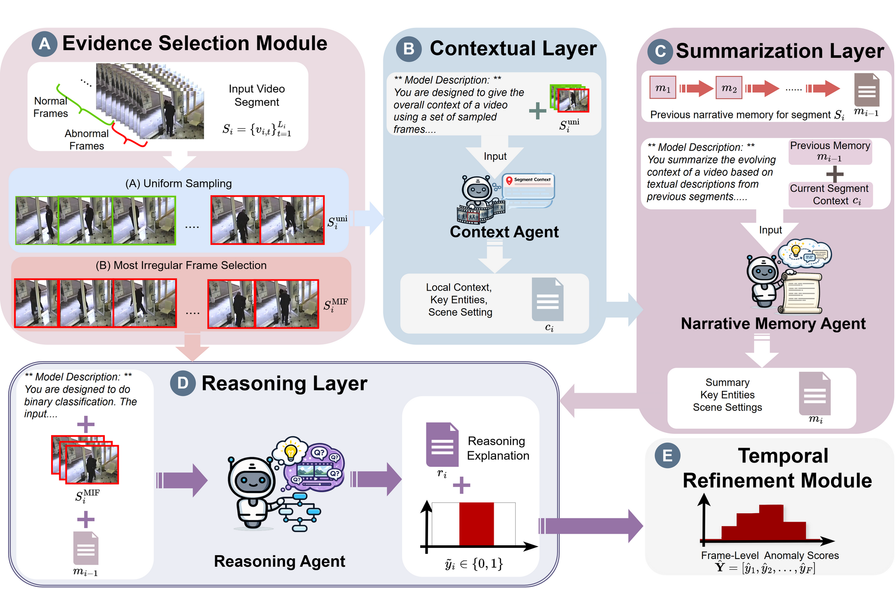

# Memory-Driven Multi-Agent Reasoning for Training-Free Video Anomaly Understanding

**VAD-Agent — Implementation and Reproducibility Suite**

This repository provides the code and released artifacts for **VAD-Agent**, the
method introduced in *Memory-Driven Multi-Agent Reasoning for Training-Free
Video Anomaly Understanding*. It supports the video anomaly detection (VAD),
video anomaly understanding (VAU), Holmes integration, and VADTree
generalization experiments presented in the paper.

Two reproducibility workflows are supported:

- **End-to-end reproduction:** rerun the complete pipeline from extracted video
  frames and model checkpoints.
- **Metric verification:** reproduce the reported metrics from the released
  prediction JSONs and cached feature artifacts.

> **Note:** Raw datasets and model checkpoints are not distributed with this
> repository.

## Overview



[Watch the VAD-Agent demo](https://moshiraabdalla.github.io/VAD-Agent/demo/) | [Download the MP4](docs/demo/VAD-Agent.mp4)

## Reproducibility at a Glance

| Experiment | Dataset / benchmark | Metrics |
| --- | --- | --- |
| `VAD-Agent` detection | UCF-Crime, XD-Violence | AUC / AP |
| `VAD-Agent MIF+Holmes` detection | UCF-Crime, XD-Violence | AUC / AP |
| `VAD-Agent` VAU | HIVAU-70K video-level split | BLEU, CIDEr, METEOR, ROUGE, BERTScore, ParaScore |
| `VAD-Agent + Holmes` VAU | HIVAU-70K video-level split | BLEU, CIDEr, METEOR, ROUGE, BERTScore, ParaScore |
| VADTree generalization | HIVAU UCF-Crime subset | AUC and semantic metrics |

## Repository Structure

| Path | Purpose |
| --- | --- |
| `src/vad_detection/` | VAD-Agent score generation, MIF frame selection, temporal refinement, and detection evaluation. |
| `src/vau_hivau/` | HIVAU-70K prediction builders and semantic evaluation code. |
| `src/holmes_integration/` | `VAD-Agent + Holmes` VAU and `VAD-Agent MIF+Holmes` detection code. |
| `src/vadtree_generalization/` | VAD-Agent integration with VADTree HGTree nodes. |
| `configs/prompts/` | Context, reasoning, summarization, and Holmes final-answer prompts. |
| `data/annotations/` | Evaluation annotations included with the repository. |
| `results/predictions/` | Released VAD-Agent segment prediction JSONs. |
| `results/cached_features/` | Cached segment features used by temporal refinement. |
| `results/holmes_mif/` | Cached Holmes MIF/ATS artifacts. |
| `results/` | Reported prediction files, metric tables, and summary JSONs. |
| `figures/` | Qualitative figures presented in the work. |
| `scripts/` | Reproduction wrappers for the main metrics and ablations. |
| `docs/` | Dataset, evaluation, and reproduction guides. |

## 0. Installation

Run all commands from the repository root:

```powershell
cd <path-to-VAD-Agent>
```

Set Python executable paths:

```powershell
$env:PYTHON = '<path-to-main-python-env>\python.exe'
$env:HOLMES_PYTHON = '<path-to-holmesvau-python-env>\python.exe'
```

Set local dataset/checkpoint paths. Keep quotes around Windows paths because
many dataset folders contain spaces.

```powershell
$env:UCF_FRAMES = 'D:\path\to\UCF-Crime\frames'
$env:XD_FRAMES = 'D:\path\to\XD-Violence\frames'
$env:UCF_VIDEOS = 'D:\path\to\UCF-Crime\videos'
$env:XD_VIDEOS = 'D:\path\to\XD-Violence\videos'
$env:HIVAU_ROOT = 'D:\path\to\HIVAU-70k'
$env:HF_CACHE = 'D:\path\to\huggingface-cache'
$env:HOLMES_CKPT = 'D:\path\to\HolmesVAU-2B'
$env:HOLMES_ATS = 'D:\path\to\holmesvau\ATS\anomaly_scorer.pth'
$env:VADTREE_UCF_ROOT = 'D:\path\to\VADTree\data\ucf'
$env:LLAVA_VIDEO_CKPT = 'D:\path\to\LLaVA-Video-7B-Qwen2'
$env:LLAVA_NEXT_REPO = 'D:\path\to\LLaVA-NeXT'
$env:LLAMA_CKPT = 'D:\path\to\Llama-2-13b-chat-hf'
$env:IMAGEBIND_REPO = 'D:\path\to\ImageBind'
$env:IMAGEBIND_CKPT = 'D:\path\to\imagebind_huge.pth'
```

For the reported experiments, VAD-Agent reuses the InternVL2 environment
configuration from [VERA](https://github.com/vera-framework/VERA). Runtime
dependencies are determined by the selected VLM backbone; the detection and
VAU experiments use InternVL2-8B for score and description generation. Prepare
an InternVL2-compatible environment by following the VERA setup instructions
and the [official InternVL installation guide](https://internvl.readthedocs.io/en/latest/get_started/installation.html).

Then install this repository's additional lightweight requirements:

```powershell
& $env:PYTHON -m pip install -r requirements.txt
```

If the VERA InternVL2 environment is already available, it can be reused for
VAD-Agent score and description generation after installing the packages listed
in `requirements.txt`. Use the [reference evaluation environment](docs/REPRODUCTION.md#reference-evaluation-environment)
to reproduce the detection and ablation metrics from the saved artifacts.

For Holmes-based experiments, follow the [official HolmesVAU environment
setup](https://github.com/pipixin321/HolmesVAU). For VADTree generalization,
follow the [official VADTree environment and model setup
instructions](https://github.com/wenlongli10/VADTree).

The semantic evaluator also requires `roberta-large` for BERTScore and ParaScore.
If the model is not cached locally, keep Hugging Face online mode enabled when
running semantic evaluation.

## 1. Data Preparation and Model Weights

Prepare extracted frame folders for:

- UCF-Crime test videos.
- XD-Violence test videos.
- HIVAU-70K video-level evaluation data.
- VADTree UCF-Crime subset if rerunning the VADTree integration.

Required checkpoints:

| Component | Used for |
| --- | --- |
| InternVL2-8B | VAD-Agent context, reasoning, and summarization agents. |
| HolmesVAU-2B | `VAD-Agent + Holmes` VAU final answering. |
| Holmes ATS anomaly scorer | Holmes MIF/ATS frame selection and detection. |
| LLaVA-Video-7B-Qwen2 | VADTree context and reasoning agents. |
| LLaMA text model | VADTree narrative memory. |
| ImageBind checkpoint | VADTree MIF frame selection. |
| `roberta-large` | BERTScore and ParaScore semantic metrics. |

The released repository already contains the annotation files, prediction JSONs,
and cached feature artifacts required to recompute the reported metrics without
rerunning the MLLMs.

## 2. Generate VAD-Agent Scores and Descriptions

This is the first step for both detection and VAU. It produces one JSON per
video. Each JSON contains segment-level model outputs, sampled frame indices,
agent descriptions, and features used later by temporal refinement.
A frozen ViT-B/16 encoder provides the frame embeddings for MIF selection
and the segment features for temporal refinement. The MIF neighborhood and
suppression parameter is `--mif-w 8` for both datasets.

### UCF-Crime

```powershell
& $env:PYTHON -m src.vad_detection.inference.generate_ucf_mif_stride150 `
  --cache-dir $env:HF_CACHE `
  --vis-root $env:UCF_FRAMES `
  --ann-root data\annotations\UCF_Eval.json `
  --save-folder results\predictions\ucf_crime_mif_stride150 `
  --segment-feature-cache-dir results\cached_features\ucf_crime_stride150 `
  --segment-len 300 `
  --segment-stride 150 `
  --context-k 16 `
  --reasoning-k 8 `
  --mif-w 8 `
  --max-new-tokens 1024 `
  --num-workers 0
```

### XD-Violence

The reported XD-Violence detection configuration uses a stride of 64:

```powershell
& $env:PYTHON -m src.vad_detection.inference.generate_xd_mif_stride64 `
  --cache-dir $env:HF_CACHE `
  --vis-root $env:XD_FRAMES `
  --ann-root data\annotations\xd_test_800.json `
  --save-folder results\predictions\xd_violence_mif_stride64 `
  --segment-feature-cache-dir results\cached_features\xd_violence_stride64 `
  --segment-len 300 `
  --segment-stride 64 `
  --context-k 16 `
  --reasoning-k 8 `
  --mif-w 8 `
  --max-new-tokens 1024 `
  --num-workers 0
```

The HIVAU-70K VAU configuration uses a stride of 150 for XD-Violence. Run the
same generator with the updated stride and write the outputs to the
VAU-specific prediction and cache directories:

```powershell
& $env:PYTHON -m src.vad_detection.inference.generate_xd_mif_stride64 `
  --cache-dir $env:HF_CACHE `
  --vis-root $env:XD_FRAMES `
  --ann-root data\annotations\xd_test_800.json `
  --save-folder results\predictions\xd_violence_mif_stride150 `
  --segment-feature-cache-dir results\cached_features\xd_violence_stride150 `
  --segment-len 300 `
  --segment-stride 150 `
  --context-k 16 `
  --reasoning-k 8 `
  --mif-w 8 `
  --max-new-tokens 1024 `
  --num-workers 0
```

The reported VAU results use the stride-150 prediction artifacts for both
UCF-Crime and XD-Violence:

```text
results/predictions/ucf_crime_mif_stride150
results/predictions/xd_violence_mif_stride150
```

To verify the reported metrics without rerunning inference, skip this generation
stage and use the released files under `results/`.

## 3. VAD-Agent Detection Evaluation (Tables 2 and 3)

For the full offline temporal refinement configuration, use the released
segment predictions or generate predictions with Section 2, then run:

```powershell
.\scripts\run_ucf_vad_agent_fused01.ps1
.\scripts\run_xd_vad_agent_fused01.ps1
```

Frame-level stride scores are assigned at their saved segment start positions. The evaluation commands use `--gap-policy hold`: the preceding score is retained through an absent output, with a zero score before the first available output. Gaussian smoothing returns one value per saved segment. The full configuration fuses `0.1` direct-segment evidence with `0.9` temporally refined evidence and then applies video-position weighting.

```text
fused_score = 0.1 * direct_segment_score + 0.9 * temporal_refined_score
final_score = video_position_weight * fused_score
```

Reference output:

```text
UCF-Crime: AUC=0.830438160, videos_used=290
XD-Violence: AUC=0.846424071, AP=0.591460854, videos_used=800
```

Reference results:

| Method | UCF-Crime AUC (%) | XD-Violence AP (%) | XD-Violence AUC (%) |
| --- | ---: | ---: | ---: |
| `VAD-Agent` | 83.04 | 59.15 | 84.64 |

To evaluate sequential inference, project the saved direct segment scores
onto frames with the following commands:

```powershell
.\scripts\run_ucf_vad_agent_fused01.ps1 -WithoutRefinement
.\scripts\run_xd_vad_agent_fused01.ps1 -WithoutRefinement
```

Sequential inference omits similarity-based retrieval, Gaussian smoothing,
score fusion, and position weighting. UCF-Crime achieves **72.08% AUC** with
sequential inference and **83.04% AUC** with full offline temporal refinement.

## 4. Holmes-Enhanced Detection: VAD-Agent MIF+Holmes

This configuration uses HolmesVAU-2B with Holmes ATS as the anomaly scorer. The
evaluation consists of two stages:

1. Prepare or validate the Holmes-CLS MIF caches.
2. Reproduce the published configuration by fusing cached MIF evidence with
   uniform-frame ATS evidence.

The cache-building command can also report diagnostic detection AUC/AP by
projecting Holmes ATS scores to the frame level. These diagnostic values are
provided only as a cache sanity check; they do not correspond to the published
`VAD-Agent MIF+Holmes` result. Use the fusion wrappers in Stage 2 to reproduce
the reference result.

For each video, Holmes visual CLS features are extracted, MIF selects
anomaly-informative frames from those features, and Holmes ATS scores the
selected frames. The cache JSONs store `selected_mif_indices`,
`selected_mif_scores`, segment metadata, and projected `frame_scores`.

### Stage 1: Prepare or Validate Holmes-CLS MIF Caches

```powershell
& $env:HOLMES_PYTHON -m src.holmes_integration.detection.compute_full_dataset_holmes_mif160_auc `
  --dataset ucf `
  --ckpt $env:HOLMES_CKPT `
  --sampler_path $env:HOLMES_ATS `
  --ann_root data\annotations\UCF_Eval.json `
  --ucf_root $env:UCF_VIDEOS `
  --frame_scores_dir results\holmes_mif\ucf\holmescls_mif160_ats_frame_scores `
  --out results\holmes_integration\detection\ucf_holmescls_mif160_ats_cache_build.json `
  --segment_len 160 `
  --segment_stride 160 `
  --dense_equivalent_stride 16 `
  --mif_w 8 `
  --batch_size 16 `
  --resume

& $env:HOLMES_PYTHON -m src.holmes_integration.detection.compute_full_dataset_holmes_mif160_auc `
  --dataset xd `
  --ckpt $env:HOLMES_CKPT `
  --sampler_path $env:HOLMES_ATS `
  --ann_root data\annotations\xd_test_800.json `
  --xd_root $env:XD_VIDEOS `
  --frame_scores_dir results\holmes_mif\xd\holmescls_mif160_ats_frame_scores `
  --out results\holmes_integration\detection\xd_holmescls_mif160_ats_cache_build.json `
  --segment_len 160 `
  --segment_stride 160 `
  --dense_equivalent_stride 16 `
  --mif_w 8 `
  --batch_size 16 `
  --resume
```

If this prints:

```text
cache already_present=290
All caches available
```

the UCF-Crime MIF caches are ready. A complete XD-Violence cache should cover
all 800 test videos. Cache files are stored under:

```text
results/holmes_mif/ucf/holmescls_mif160_ats_frame_scores/
results/holmes_mif/xd/holmescls_mif160_ats_frame_scores/
```

### Stage 2: Evaluate the Reference MIF+Holmes Configuration

The following wrappers reproduce the Holmes-enhanced detection results from the
MIF caches and uniform-frame ATS evidence:

```powershell
powershell -ExecutionPolicy Bypass -File src\holmes_integration\detection\run_ucf_mif_holmes_expmax128.ps1
powershell -ExecutionPolicy Bypass -File src\holmes_integration\detection\run_xd_mif_holmes_linear.ps1
```

Inspect the output JSONs:

```powershell
Get-Content results\holmes_integration\detection\ucf_full_mif_uniform_union_auc_expmax128.json
Get-Content results\holmes_integration\detection\xd_full_mif_uniform_union_auc_linear.json
```

Reference results:

| Method | UCF-Crime AUC (%) | XD-Violence AP (%) | XD-Violence AUC (%) |
| --- | ---: | ---: | ---: |
| `VAD-Agent MIF+Holmes` | 87.18 | 87.07 | 95.61 |

## 5. VAU Evaluation: VAD-Agent

Build the HIVAU-70K video-level prediction file from the saved segment outputs:

```powershell
& $env:PYTHON -m src.vau_hivau.inference.build_vad_agent_hivau_video_predictions `
  --instructions data\annotations\hivau_merge_instruction_test_final.jsonl `
  --ucf-score-folder results\predictions\ucf_crime_mif_stride150 `
  --xd-score-folder results\predictions\xd_violence_mif_stride150 `
  --out results\vau_hivau\vad_agent\mif_hivau_video_original_task_predictions.json `
  --meta-out results\vau_hivau\vad_agent\mif_hivau_video_original_task_predictions_meta.json
```

Reference build output:

```text
input_video_instruction_rows=398
output_rows=398
missing_count=0
```

This prediction file is evaluated against the original HIVAU video-level
questions. Ground-truth answers are used only by the evaluator.

## 6. VAU Evaluation: VAD-Agent + Holmes

This configuration uses HolmesVAU-2B as the final HIVAU question-answering MLLM.
Visual evidence is selected using a MIF+ATS mixture. The command below reads the
Holmes-CLS MIF caches from Section 4; it does not create new caches. For each
video-level question, it combines 6 MIF frames with 6 ATS frames.

```powershell
& $env:HOLMES_PYTHON -m src.holmes_integration.vau.hivau_question_context_summary_inference `
  --ckpt $env:HOLMES_CKPT `
  --sampler_path $env:HOLMES_ATS `
  --hivau_root $env:HIVAU_ROOT `
  --ucf_root $env:UCF_FRAMES `
  --xd_root $env:XD_FRAMES `
  --granularity video `
  --out results\vau_hivau\vad_agent_holmes\hivau_video_question_context_summary_mafats_taskhybrid_predictions.json `
  --select_frames 12 `
  --context_frames 8 `
  --dense_sample_freq 16 `
  --use_MIF_ATS_frames `
  --mif_ats_mif_frames 6 `
  --mif_ats_ats_frames 6 `
  --ucf_mif_cache_dir results\holmes_mif\ucf\holmescls_mif160_ats_frame_scores `
  --xd_mif_cache_dir results\holmes_mif\xd\holmescls_mif160_ats_frame_scores `
  --final_prompt_source task_files `
  --resume
```

Released output:

```text
results/vau_hivau/vad_agent_holmes/hivau_video_question_context_summary_mafats_taskhybrid_predictions.json
```

## 7. Evaluate VAU Semantic Metrics

The reported BLEU score sums BLEU-1 through BLEU-4. The saved metric files
use `PaScore` as the key for ParaScore.

Run the semantic evaluator for both VAU configurations:

```powershell
$env:HF_HUB_OFFLINE = '0'
$env:TRANSFORMERS_OFFLINE = '0'
.\scripts\evaluate_hivau_semantics.ps1
```

Reference results:

| Method | BLEU | CIDEr | METEOR | ROUGE | BERTScore | ParaScore |
| --- | ---: | ---: | ---: | ---: | ---: | ---: |
| `VAD-Agent` | 0.263 | 1.088 | 0.134 | 0.262 | 0.878 | 0.879 |
| VAD-Agent† (+ Holmes) | 0.787 | 1.574 | 0.155 | 0.392 | 0.910 | 0.911 |

Metric files are written under:

```text
results/vau_hivau/vad_agent/
results/vau_hivau/vad_agent_holmes/
```

## 8. VADTree Generalization

VADTree setup and checkpoint preparation should follow the official VADTree
repository: [wenlongli10/VADTree](https://github.com/wenlongli10/VADTree).

The experiment keeps the VADTree HGTree temporal decomposition fixed and
applies VAD-Agent to the fine-grained HGTree nodes. ImageBind is used only for
MIF frame selection within each node.

Run VAD-Agent on the VADTree fine-grained nodes:

```powershell
& $env:PYTHON -m src.vadtree_generalization.run_agentic_mif `
  --dataset-root $env:VADTREE_UCF_ROOT `
  --dataset ucf `
  --output-dir results\vadtree_generalization\ucf_full_llama_narrative `
  --segment-size 300 `
  --context-samples 16 `
  --reasoning-samples 8 `
  --narrative-agent llama `
  --llava-pretrained $env:LLAVA_VIDEO_CKPT `
  --llava-repo $env:LLAVA_NEXT_REPO `
  --llama-ckpt $env:LLAMA_CKPT `
  --imagebind-repo $env:IMAGEBIND_REPO `
  --imagebind-checkpoint $env:IMAGEBIND_CKPT `
  --resume `
  --continue-on-error
```

Export the fine-node scores:

```powershell
& $env:PYTHON -m src.vadtree_generalization.export_agentic_vid_score `
  --results-dir results\vadtree_generalization\ucf_full_llama_narrative `
  --output-json results\vadtree_generalization\agentic_results.json `
  --complete-only
```

Fuse VADTree coarse scores with VAD-Agent fine-node scores:

```powershell
& $env:PYTHON -m src.vadtree_generalization.fuse_coarse_fine_scores `
  --dataset ucf `
  --coarse-json results\vadtree_generalization\vadtree_raw_fused_beta0.2.json `
  --fine-json results\vadtree_generalization\agentic_results.json `
  --label ours_raw_fused `
  --beta 0.2 `
  --output-json results\vadtree_generalization\ours_raw_fused_beta0.2.json
```

Released VADTree artifacts:

```text
results/vadtree_generalization/vadtree_raw_fused_beta0.2.json
results/vadtree_generalization/ours_raw_fused_beta0.2.json
```

Reference results:

| Method | AUC (%) | BLEU | CIDEr | METEOR | ROUGE | BERTScore | ParaScore |
| --- | ---: | ---: | ---: | ---: | ---: | ---: | ---: |
| `VADTree` | 77.94 | 0.171 | 1.534 | 0.126 | 0.277 | 0.870 | 0.871 |
| `VAD-Agent + VADTree` | 78.34 | 0.300 | 1.540 | 0.116 | 0.283 | 0.879 | 0.879 |

## 9. Ablations

Run the paper ablations from the repository root with the reference evaluation
environment described in Section 0:

```powershell
$env:PYTHON = '<path-to-evaluation-env>\python.exe'
.\scripts\run_paper_ablations.ps1
```

Run selected tables with:

```powershell
.\scripts\run_paper_ablations.ps1 -Table 5,7
```

The runner reads [`configs/paper_ablations.json`](configs/paper_ablations.json) and evaluates the released cached predictions and features without loading an MLLM. Each run writes `metrics.json`, `commands.json`, and logs to a unique directory under `results/vad_detection/ablations/runs/`.

### Table 5: Context and Narrative Memory Agents

| Configuration | AUC (%) |
| --- | ---: |
| Context Agent only | 77.73 |
| Previous reasoning memory | 80.96 |
| Full VAD-Agent | 83.04 |

### Table 6: Segment Stride

| Stride (frames) | UCF-Crime AUC (%) | XD-Violence AUC (%) |
| ---: | ---: | ---: |
| 300 | 79.74 | 83.68 |
| 150 | 83.04 | 84.04 |
| 64 | 79.82 | 84.64 |

### Table 7: Sequential Inference and Offline Temporal Refinement

| Operation | UCF-Crime AUC (%) | Gain (pp) |
| --- | ---: | ---: |
| Initial segment scores (without temporal refinement) | 72.08 | - |
| Initial + similarity retrieval | 75.70 | +3.62 |
| Initial + similarity retrieval + Gaussian smoothing | 82.31 | +6.61 |
| Refinement with position weighting | 82.83 | +0.53 |
| Full refinement with direct-score fusion | 83.04 | +0.21 |

Rows 2–5 use offline temporal refinement.

### Table 8: Narrative Agent Backbone

| Narrative agent | Reasoning agent | AUC (%) |
| --- | --- | ---: |
| LLaMA | InternVL2-8B | 79.36 |
| InternVL2-8B | InternVL2-8B | 83.04 |

### Table 9: Sampling Assignment on the HIVAU UCF Subset

The paper sampling study uses the same 60 videos listed in `data/annotations/hivau_test_ucf_crime_videos.txt` for every variant.

| Variant | Context frames | Reasoning frames | AUC (%) |
| --- | ---: | ---: | ---: |
| Uniform for both agents | 8 | 8 | 83.98 |
| MIF for both agents | 8 | 8 | 85.48 |
| Uniform context + MIF reasoning | 8 | 8 | 86.86 |

### Full UCF Sampling Evaluation

The full UCF-Crime evaluation uses all 290 test videos. Its sampling results have a different evaluation scope from the 60-video paper study.

| Variant | Context frames | Reasoning frames | AUC |
| --- | ---: | ---: | ---: |
| Uniform for both agents | 8 | 8 | 0.792794417 |
| MIF for both agents | 8 | 8 | 0.802549996 |
| Uniform context + MIF reasoning | 8 | 8 | 0.800478823 |
| Uniform context + MIF reasoning | 16 | 8 | 0.830438160 |

Additional evaluation commands:

```powershell
.\scripts\run_ucf_sampling_ablation.ps1
.\scripts\run_stride_ablation.ps1
```

Artifact maps and detailed commands are documented in [`docs/REPRODUCTION.md`](docs/REPRODUCTION.md).

## 10. Qualitative Figures

Render the four panels from Figure 6 using the frame directories configured in Section 0:

```powershell
& $env:PYTHON scripts\make_raw_auc_qualitative_composite.py
```

The figures show representative video frames, full saved agent outputs, and direct and final anomaly scores. The XD examples read decisions and agent text from the same JSONs in `results/predictions/xd_violence_mif_stride64_2`. Temporal refinement uses the existing cached segment features.

| Example | PDF | PNG |
| --- | --- | --- |
| UCF-Crime abnormal | [PDF](figures/qualitative/paper/qualitative_ucf_abnormal.pdf) | [PNG](figures/qualitative/paper/qualitative_ucf_abnormal.png) |
| XD-Violence abnormal | [PDF](figures/qualitative/paper/qualitative_xd_abnormal.pdf) | [PNG](figures/qualitative/paper/qualitative_xd_abnormal.png) |
| UCF-Crime normal | [PDF](figures/qualitative/paper/qualitative_ucf_normal.pdf) | [PNG](figures/qualitative/paper/qualitative_ucf_normal.png) |
| XD-Violence normal | [PDF](figures/qualitative/paper/qualitative_xd_normal.pdf) | [PNG](figures/qualitative/paper/qualitative_xd_normal.png) |

The output directory also contains the plotted arrays and the corresponding text and source metadata.

## Acknowledgements

This repository builds on [VERA](https://github.com/vera-framework/VERA) and the
public model and code ecosystems of InternVL, HolmesVAU, VADTree, LLaVA-Video,
ImageBind, and the UCF-Crime, XD-Violence, and HIVAU-70K datasets.

For setup instructions, refer to the official
[HolmesVAU](https://github.com/pipixin321/HolmesVAU) and
[VADTree](https://github.com/wenlongli10/VADTree) repositories.

## Citation

If you find this work useful in your research, please consider citing our
paper. The manuscript has been submitted to *IPM* and is currently under review. 